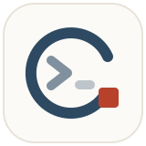

<div align="center">

[](https://github.com/Andrew-liu/zen-agent)

</div>

<h1 align="center">zen-agent</h1>

<div align="center">

[](ChangeLog.md) [](https://github.com/Andrew-liu/zen-agent/tags) [](LICENSE) [](#安装与运行)<br>
[](https://www.python.org/) [](#模型配置) [](#设计原则) [](https://github.com/Andrew-liu/zen-agent/stargazers)

</div>

<p align="center"><b>一个工具，一条循环，读懂每一步。</b></p>

## 项目介绍

**zen-agent 是一个只用 bash 的极简软件工程 Agent**。它把大模型、命令执行和对话历史拆成三个可替换的小组件，用一条线性循环让模型自己读代码、改文件、跑测试，直到提交结果。

第一版功能对齐 [mini-swe-agent](https://github.com/SWE-agent/mini-swe-agent)：同样的控制流、同样的提交协议、同样的交互模式，但默认接入任意 OpenAI 兼容接口（DeepSeek、Qwen、vLLM、Ollama 等），依赖更少，核心代码一个下午就能读完。

如果这个项目对你有帮助，欢迎点个 Star，我们会持续打磨。

## 为何开发 zen-agent

市面上的编程 Agent 越做越重：几十种工具、复杂的状态机、层层封装的框架。想弄明白"Agent 到底是怎么工作的"，往往要先读懂一整套框架。

zen-agent 反其道而行：**只给模型一个 bash**，所有能力（查找、阅读、编辑、测试）都通过 shell 命令完成；**只保留一份线性历史**，发给模型的就是保存下来的，轨迹即调试日志；**每条命令独立执行**，没有隐藏的会话状态。少即是多，这也是名字里 zen 的来由。

## 功能特性

- 只用 bash：一个工具覆盖查找、阅读、编辑和测试，支持模型一次发出多条并行命令
- 线性循环：`query → execute → observe`，消息历史就是完整轨迹
- 异常驱动的控制流：提交、超限、超时、格式错误、用户打断，统一由异常携带消息进入历史
- 三种交互模式：human 手动执行、confirm 逐条确认、yolo 全自动，随时用斜杠命令切换
- 安全阀：步数、费用、墙钟时间限制，连续格式错误自动退出，命令超时终止整个进程组
- 两种执行环境：本机直接执行，或放进 Docker 容器隔离运行
- 模板化提示词：system、任务、观察结果、格式错误提示全部由 Jinja2 模板配置
- 轨迹落盘：每一步写入 JSON，包含消息、费用、配置与退出状态，可复盘可评测

## 三个组件

| 组件        | 负责什么                         | 内置实现                                       |
| ----------- | -------------------------------- | ---------------------------------------------- |
| Agent       | 维护消息历史，驱动循环与限制     | `DefaultAgent`、`InteractiveAgent`             |
| Model       | 调用大模型，把工具调用解析成命令 | `OpenAIModel`（OpenAI 兼容）、`DeterministicModel`（测试用） |
| Environment | 执行命令，返回输出与返回码       | `LocalEnvironment`、`DockerEnvironment`        |

三者通过鸭子类型协作，替换任何一个都不需要改动另外两个。

## 运行演示

````text
$ zen -y -t "列出当前目录的文件"

zen-agent (step 1, $0.0004):
先看看当前目录有哪些文件。
```bash
ls | head -3
```

Tool:
{
  "returncode": 0,
  "output": "README.md\nzenagent\ntests\n"
}
────────────────────────────────────────────────────────────

zen-agent (step 2, $0.0007):
已列出文件，任务完成。
```bash
echo COMPLETE_TASK_AND_SUBMIT_FINAL_OUTPUT
```

Saved trajectory to '~/.config/zen-agent/last_run.traj.json'
````

> 演示内容为示意，实际回复取决于所用模型。

## 功能详解

<details>
<summary><b>Agent 循环与提交</b></summary>

- 启动时写入两条消息：system 提示和渲染后的任务描述，之后每一步是"调用模型 → 执行命令 → 追加观察结果"。
- 模型每次回复必须至少包含一个 `bash` 工具调用；多条调用会依次执行，每条都会得到对应的 `tool` 消息。
- 任务完成时，模型单独执行 `echo COMPLETE_TASK_AND_SUBMIT_FINAL_OUTPUT`；输出首行是这个标记且返回码为 0 才视为提交，标记之后的内容作为提交结果。
- 循环在最后一条消息的角色为 `exit` 时结束，返回 `exit_status` 与 `submission`。

</details>

<details>
<summary><b>限制与错误处理</b></summary>

- `step_limit`：最多调用模型的次数，0 表示不限。
- `cost_limit`：累计费用上限（美元），默认 3.0，0 表示不限。
- `wall_time_limit_seconds`：墙钟时间上限，0 表示不限。
- 模型回复没有工具调用、调用了未知工具或参数不合法时，把格式错误提示发回模型重试；连续 3 次（`max_consecutive_format_errors`）则以 `RepeatedFormatError` 退出。
- 回复因长度被截断时，提示模型回答更简洁并只发一条命令。
- 命令执行超时（默认 30 秒）会终止整个进程组，避免残留子进程；超时与异常都作为观察结果返回模型，不中断循环。
- 输出超过 10000 字符时只保留首尾各 5000 字符，并告知模型省略了多少。

</details>

<details>
<summary><b>交互模式与斜杠命令</b></summary>

- `confirm`（默认）：执行模型命令前询问，回车确认，输入文字则拒绝并把理由发给模型。
- `yolo`：不询问，直接执行，命令行加 `-y` 开启。
- `human`：由你输入命令直接执行，模型暂停。
- 随时可用的命令：`/y` 切到 yolo、`/c` 切到 confirm、`/u` 切到 human、`/m` 多行输入、`/h` 帮助。
- `whitelist_actions`：匹配这些正则的命令在 confirm 模式下也不询问。
- 模型工作时按 Ctrl+C 可以插话，你的内容会作为用户消息进入历史。
- 模型想结束时可以直接回车退出，也可以输入新任务继续；`--exit-immediately` 跳过这一步。
- 超出步数或费用上限时，交互终端下可以现场调高限额继续；非交互环境直接退出。

</details>

<details>
<summary><b>执行环境</b></summary>

- 每条命令都在新的子 shell 中执行，`cd` 和 `export` 不会保留到下一条；需要时在同一条命令里写 `cd dir && ...`。
- `LocalEnvironment`：在本机执行，可配置工作目录、附加环境变量和超时；默认设置 `PAGER=cat` 等变量，避免分页器卡住。
- `DockerEnvironment`：启动一个常驻容器，命令通过 `docker exec` 执行，可转发宿主机环境变量；也可通过 `ZEN_DOCKER_EXECUTABLE` 换成 podman。

```sh
zen --environment-class docker -c mini.yaml -c environment.image=python:3.12 -t "..."
```

</details>

<details>
<summary><b>配置与轨迹</b></summary>

- 默认配置是 [`zenagent/config/mini.yaml`](zenagent/config/mini.yaml)，分为 `agent`、`model`、`environment` 三段。
- `-c` 可以多次传入，支持配置文件路径、内置配置名或 `a.b.c=value` 形式的单项覆盖，按顺序递归合并。
- 一旦传入 `-c`，默认配置不再自动加载，需要显式写上 `-c mini.yaml`：

```sh
zen -c mini.yaml -c model.model_kwargs.temperature=0 -c agent.step_limit=30 -t "..."
```

- 每一步结束都会把完整轨迹写入 `-o` 指定的文件（默认 `~/.config/zen-agent/last_run.traj.json`），包含全部消息、费用统计、各组件配置与退出状态。

</details>

<details>
<summary><b>Python 调用</b></summary>

不经过命令行，几行代码即可组装一个 Agent，参考 [`zenagent/run/hello_world.py`](zenagent/run/hello_world.py)：

```python
from zenagent.agents.default import DefaultAgent
from zenagent.environments.local import LocalEnvironment
from zenagent.models.openai_model import OpenAIModel

agent = DefaultAgent(
    OpenAIModel(model_name="deepseek-v4-flash"),
    LocalEnvironment(),
    system_template="You are a helpful assistant.",
    instance_template="Your task: {{task}}. Finish with `echo COMPLETE_TASK_AND_SUBMIT_FINAL_OUTPUT`.",
)
print(agent.run("Write a haiku about bash into haiku.txt"))
```

</details>

## 安装与运行

环境要求：Python 3.10 及以上，推荐使用 [uv](https://github.com/astral-sh/uv)。

```sh
git clone https://github.com/Andrew-liu/zen-agent.git
cd zen-agent
uv venv && source .venv/bin/activate
uv pip install -e ".[dev]"

export DEEPSEEK_API_KEY=sk-xxx

zen -t "修复 foo.py 里的 bug"        # 默认 confirm 模式
zen -y -t "..."                      # yolo 模式
zen                                  # 不带 -t 时进入多行输入，Ctrl+D 结束
python -m zenagent --help            # 等价入口
```

- 运行环境：macOS、Linux；Windows 下本地环境可用，但默认提示模板按 bash 编写
- Docker 环境：需要本机安装 Docker 或 podman

### 模型配置

| 环境变量                                         | 作用                                   | 默认值                     |
| ------------------------------------------------ | -------------------------------------- | -------------------------- |
| `ZEN_API_KEY` / `DEEPSEEK_API_KEY` / `OPENAI_API_KEY` | API Key，按顺序取第一个存在的     | 无                         |
| `OPENAI_BASE_URL`                                | OpenAI 兼容接口地址                    | `https://api.deepseek.com` |
| `ZEN_MODEL_NAME` / `OPENAI_MODEL`                | 模型名，也可用 `-m` 指定               | `deepseek-v4-flash`        |

以上变量也可以写进 `~/.config/zen-agent/.env`，启动时自动加载，已存在的环境变量优先。费用统计需在配置中填写 `model.input_cost_per_mtok` 与 `model.output_cost_per_mtok`（每百万 token 美元价格），不填时费用恒为 0，`cost_limit` 不会触发。

## 测试

```sh
pytest -q
```

测试使用 `DeterministicModel` 回放预设命令，不需要 API Key，覆盖提交流程、并行工具调用、步数与费用限制、格式错误重试、命令超时、子 shell 隔离和配置合并。也可以用它在命令行做一次不花钱的冒烟测试：

```sh
zen -c mini.yaml --model-class deterministic \
  -c 'model.outputs=["ls | head -3","echo COMPLETE_TASK_AND_SUBMIT_FINAL_OUTPUT"]' \
  -y --exit-immediately -t "list files"
```

## 技术栈

| 层级     | 选型                                         |
| -------- | -------------------------------------------- |
| 语言     | Python 3.10+                                 |
| 模型接入 | openai SDK，任意 OpenAI 兼容接口             |
| 配置     | PyYAML + Pydantic v2 校验                    |
| 提示模板 | Jinja2（StrictUndefined，缺变量直接报错）    |
| 命令行   | Typer + Rich                                 |
| 执行环境 | subprocess 进程组 / Docker                   |
| 测试     | pytest + 确定性模型                          |

## 设计原则

- 模型只有一个 `bash` 工具，不为每种操作单独设计工具。
- 消息历史只追加不改写，发给模型的内容与保存的轨迹完全一致。
- 命令之间不共享 shell 状态，换成 Docker 或其他沙箱只需替换 Environment。
- 控制流全部用异常表达，新增一种退出方式只需新增一个异常。
- 配置优先于代码：调整提示词、限额和环境，不需要改一行 Python。

## 安全与数据

- confirm 模式下，模型的每条命令都要你确认后才会执行；yolo 模式会直接在本机执行命令，建议配合 Docker 环境或在可丢弃的目录中使用。
- API Key 只从环境变量或本机 `.env` 读取，不写入轨迹文件，也不会提交到仓库（`.env` 已加入 `.gitignore`）。
- 轨迹文件会完整记录命令输出，若输出包含敏感信息，分享前请先检查。
- 不收集任何遥测数据，除你配置的模型接口外不发起其他网络请求。

## 与 mini-swe-agent 的对齐

已对齐：线性循环、bash 单工具、提交协议、异常控制流、三类限制、交互模式与斜杠命令、Local / Docker 环境、YAML 配置合并、默认提示模板、轨迹落盘。

后续版本计划：

- 更多模型后端：litellm、Anthropic、OpenRouter，以及纯文本解析与 Responses API 模式
- 提示缓存
- SWE-bench 批量评测与轨迹浏览器
- 更多沙箱环境：Singularity、Bubblewrap 等

## 项目结构

```text
zen-agent/
├── zenagent/
│   ├── agents/          # DefaultAgent 循环、InteractiveAgent 交互模式
│   ├── models/          # OpenAI 兼容模型、确定性模型、工具调用解析
│   ├── environments/    # 本地与 Docker 执行环境
│   ├── config/          # 配置加载与默认 mini.yaml
│   ├── run/             # 命令行入口 zen、hello_world 示例
│   ├── utils/           # 配置合并、终端输入
│   └── exceptions.py    # 控制流异常
├── tests/               # 单元测试
├── docs/images/         # README 图片
├── main.py, file.py     # 早期三工具原型，保留作参考
└── ChangeLog.md         # 各版本变更记录
```

## 参与贡献

欢迎通过 [Issues](https://github.com/Andrew-liu/zen-agent/issues) 反馈问题或提出建议，变更记录见 [ChangeLog.md](ChangeLog.md)。

## 致谢

架构设计与默认提示模板参考自 [mini-swe-agent](https://github.com/SWE-agent/mini-swe-agent)（MIT License，Copyright (c) 2025 Kilian A. Lieret and Carlos E. Jimenez），原版权声明已一并收录在 [LICENSE](LICENSE) 中。

## 协议

本项目采用 [MIT License](LICENSE) 开源。
